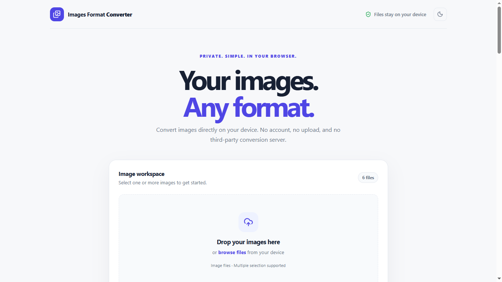
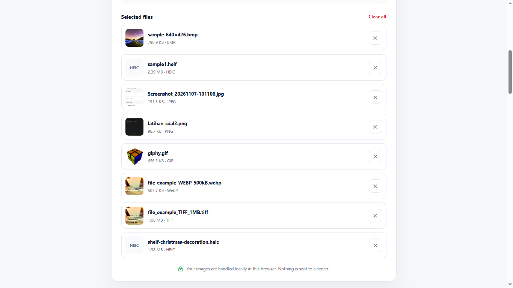
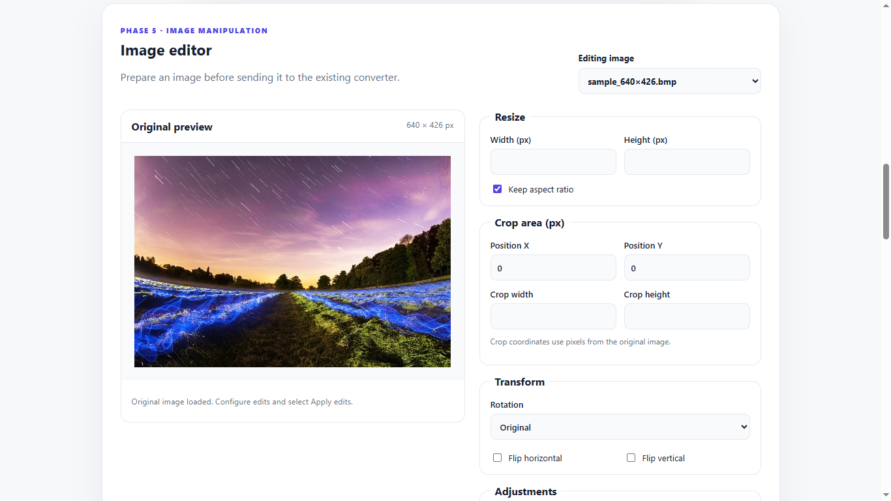
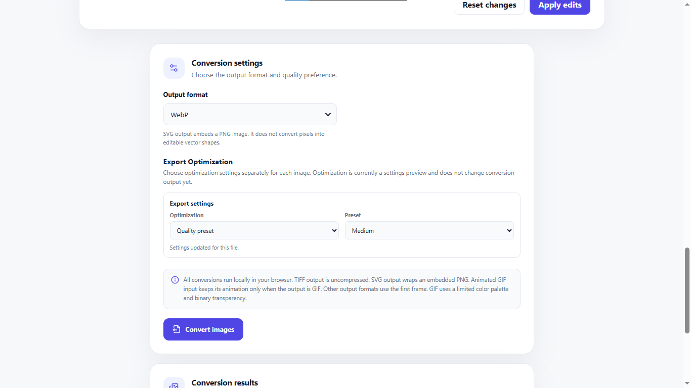
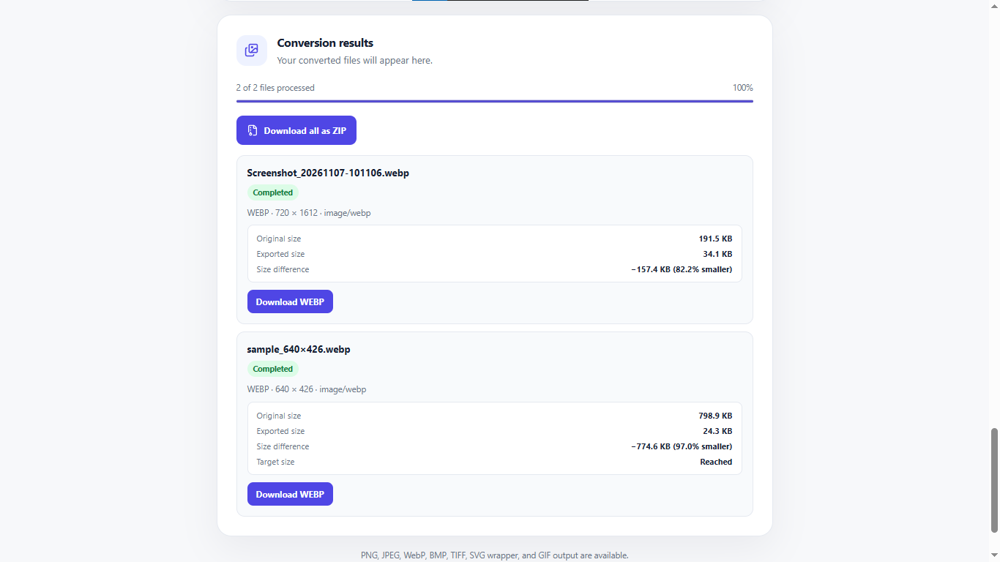
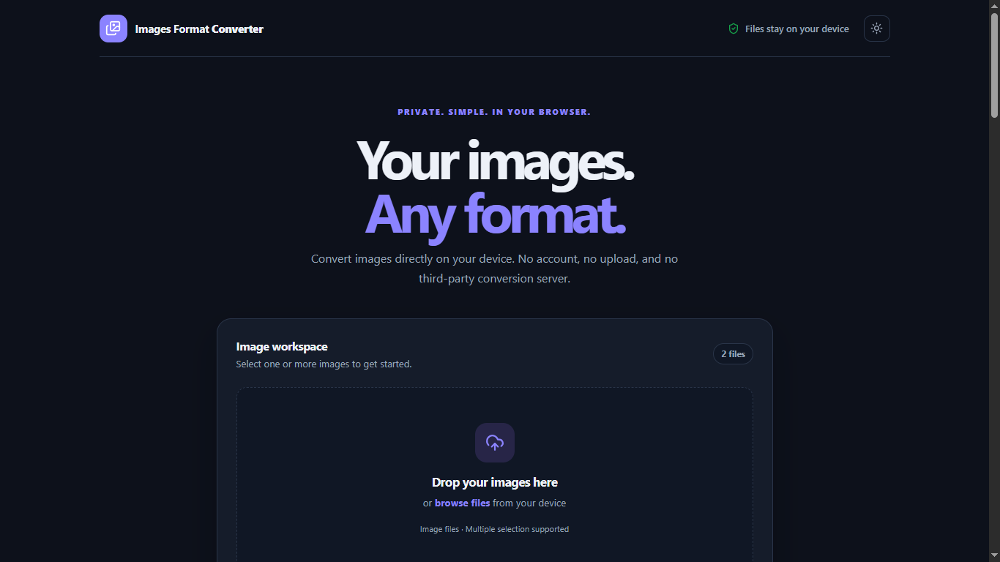
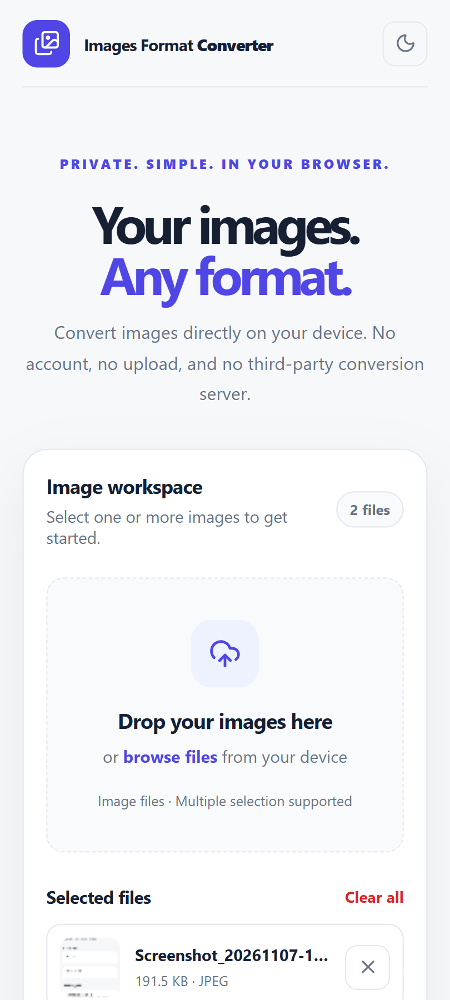

<div align="center">

# Images Format Converter

**A privacy-focused, browser-based image converter with editing and optimization tools.**

Convert, edit, and optimize image files directly in your browser. Your images stay on your device and are not uploaded to a conversion server.


</div>

<p align="center">
  
</p>

## Overview

**One workspace for every image task. No uploads. No unnecessary steps.**

Converting images should not mean opening several websites, repeating the same steps, or handing your files to an unknown server. Images Format Converter gives you a straightforward workspace to convert, edit, and optimize images right from your browser.

Bring multiple files into one batch, choose the format you need, make adjustments in the built-in editor, and fine-tune JPEG or WebP exports. Review previews and file details, follow conversion progress, compare original and output sizes, then download each result or everything together in a ZIP archive.

Your images stay on your device throughout the conversion process. There is no account to create and no conversion server to upload your files to. Whether you are preparing website assets, managing design resources, or handling everyday image files, you can get the job done in one place.

**Drop your images. Make them yours. Convert with confidence.**

## Contents

- [Overview](#overview)
- [Features](#features)
- [Supported formats](#supported-formats)
- [Privacy and local processing](#privacy-and-local-processing)
- [Technology stack](#technology-stack)
- [Getting started](#getting-started)
- [Available commands](#available-commands)
- [Project structure](#project-structure)
- [Development roadmap](#development-roadmap)
- [Documentation](#documentation)
- [About](#about)

## Features

### Image conversion

Add images with the file picker or drag and drop, then process them together in one batch. Preview each file, check its details, and keep track of what is ready to convert.

<p align="center">
  
</p>

- Select files using the file picker or drag and drop.
- Convert multiple files in one batch.
- Preview selected images and inspect file details.
- Validate generated output before making it available for download.

### Image editing

Make common adjustments before exporting, without switching to another editor. The built-in editor gives you control over image dimensions, framing, orientation, and visual adjustments.

<p align="center">
  
</p>

The integrated editor supports:

- Resize with aspect-ratio locking.
- Crop.
- Rotate by 90, 180, or 270 degrees.
- Horizontal and vertical flip.
- Brightness, contrast, saturation, and blur adjustments.
- Grayscale and sepia effects.
- Preview, reset, and apply actions before conversion.

### Export optimization

Choose an output quality that fits your needs. Use ready-made presets or set a target file size for JPEG and WebP, then review the actual result before downloading.

<p align="center">
  
</p>

- Low, Medium, and High presets for JPEG and WebP.
- Best-effort Target Size for JPEG and WebP.
- Actual source and output file-size reporting.
- Byte and percentage difference reporting.
- Output validation and per-file error handling.
- ZIP export reuses the validated output generated for each file.

Target Size is best-effort. The encoder may not be able to reach the exact requested size. The application reports the achieved result instead of promising an exact match.

### Batch processing

Follow each file as it moves through the conversion queue. Successful results remain available even when another file encounters an error.

<p align="center">
  
</p>

- Per-file processing states and batch progress.
- Web Worker processing when supported by the browser.
- Main-thread fallback when Worker processing is unavailable.
- Sequential processing to limit memory usage.
- Cancellation of remaining queued files.
- Failure isolation so one failed file does not automatically stop unrelated files.

### Interface

Use the workspace in the theme and screen size that suit you. The layout adapts from desktop to mobile, with light and dark themes available.

<p align="center">
  
</p>
<p align="center">
  
</p>

- Light and dark themes.
- Saved theme preference.
- Responsive desktop and mobile layouts.
- Keyboard-accessible controls and custom format dropdown.
- Startup skeleton while the application initializes.

## Supported formats

Input decoding and output encoding are separate capabilities. A format being accepted as input does not mean the application can export to that same format.

| Format | Input | Output | Notes |
|---|:---:|:---:|---|
| PNG | Yes | Yes | Transparency supported |
| JPEG / JPG | Yes | Yes | Transparency is composited onto a background |
| WebP | Yes | Yes | Quality presets and Target Size are available |
| BMP | Yes | Yes | Dedicated 24-bit output encoder |
| HEIC / HEIF | Yes | No | Input decoding only |
| TIFF | Yes | Yes | Baseline uncompressed TIFF output |
| SVG | Yes | Yes | Sanitized input rasterization; output is an SVG wrapper containing an embedded PNG |
| GIF | Yes | Yes | First-frame input for raster conversion; animated GIF-to-GIF and static-image-to-GIF are supported |

Important format limitations:

- SVG output is not true vectorization. It wraps a PNG image inside an SVG document.
- Animated GIF preservation is supported for GIF-to-GIF. Animated GIF-to-WebP or APNG is not currently supported.
- TIFF output is baseline uncompressed and does not provide multi-page TIFF export.
- HEIC/HEIF is currently an input format only.
- Optimization presets and Target Size are available for JPEG and WebP. Other output formats use the normal encoder path without the optimization modes.

## Privacy and local processing

Images are processed locally in your browser.

- Image files are not uploaded to a remote conversion server.
- No application account is required.
- The application does not need a backend or database for its core conversion workflow.
- Web Workers are used where supported to keep processing away from the main UI thread.

The development server and package manager need an internet connection to install dependencies. That is separate from processing images in the application.

## Technology stack

| Area | Technology |
|---|---|
| Language | Vanilla JavaScript with ES modules |
| Markup | HTML5 |
| Styling | Plain CSS3 |
| Development server and bundler | Vite 7 |
| Icons | Lucide |
| Batch archive | JSZip |
| HEIC / HEIF decoding | heic-to |
| TIFF decoding and encoding | UTIF2 |
| GIF decoding | gifuct-js |
| GIF encoding | modern-gif |
| Processing | Browser APIs, Canvas, and Web Workers |
| Testing | Node.js built-in test runner |

## Getting started

This guide uses Windows 10/11 and PowerShell. The commands are also easy to adapt for macOS or Linux.

### 1. Install Git

Git is used to download the project source code and manage changes.

1. Open the [Git for Windows download page](https://git-scm.com/download/win).
2. Download and run the installer.
3. Use the default installation options if you are unsure which options to choose.
4. Finish the installation.
5. Open PowerShell and verify Git:

```powershell
git --version
```

If PowerShell cannot find `git`, close the terminal, open it again, and retry.

### 2. Install Node.js and npm

Node.js runs JavaScript development tools on your computer. npm is the package manager used to install this project's dependencies.

This project uses Vite 7. Use Node.js 22.12 or newer in the Node 22 line to match the project's CI environment. Vite 7 requires Node.js 20.19+ or 22.12+.

1. Open the [official Node.js download page](https://nodejs.org/en/download/).
2. Download the Windows Installer (`.msi`) for the Node.js 22 LTS release. If the main download page only shows a newer major version, use the [Node.js 22 release archive](https://nodejs.org/en/download/archive/v22.23.5/).
3. Run the installer.
4. Keep the option to install npm and add Node.js to PATH enabled.
5. Finish the installation.
6. Close and reopen PowerShell.
7. Verify both tools:

```powershell
node -v
npm -v
```

Both commands should print a version number. You do not need to install npm separately when using the official Windows Node.js installer.

### 3. Install a code editor

A code editor is not required to run the application, but it makes development easier.

[Visual Studio Code](https://code.visualstudio.com/) is a recommended option. Download it, run the installer, and open the project folder after cloning the repository.

### 4. Clone the repository

Open PowerShell in the directory where you want to keep your projects. Run:

```powershell
git clone https://github.com/andra-gs/Images-Format-Converter.git
cd Images-Format-Converter
```

You now have a local copy of the repository.

### 5. Install project dependencies

The repository includes `package-lock.json`. Use `npm ci` to install the exact dependency versions recorded in the lockfile:

```powershell
npm ci
```

Wait until npm finishes. It will create the `node_modules` directory. You do not need to install Vite, Lucide, or the other project packages globally.

### 6. Start the development server

Run:

```powershell
npm run dev
```

Vite will print a local address, usually:

```text
http://localhost:5173/
```

Open that address in your browser. Keep the terminal running while you use the development version. To stop the server, press `Ctrl+C` in the terminal.

### 7. Run tests and create a production build

Run the automated test suite:

```powershell
npm test
```

Create a production build:

```powershell
npm run build
```

Vite writes the production files to the `dist/` directory. To preview that build locally, run:

```powershell
npm run preview
```

Use the local address printed by Vite to open the preview.

## Available commands

| Command | Description |
|---|---|
| `npm ci` | Install dependencies from the lockfile |
| `npm run dev` | Start the Vite development server |
| `npm test` | Run automated tests with Node.js |
| `npm run build` | Generate the production build in `dist/` |
| `npm run preview` | Preview the production build locally |

## Project structure

```text
Images-Format-Converter/
├── docs/
│   ├── screenshots/       # Project screenshots for the README
│   └── ...                # Technical and phase documentation
├── public/                # Static public assets
├── src/
│   ├── js/
│   │   ├── core/          # Conversion, transformation, optimization
│   │   ├── ui/            # User interface modules
│   │   └── workers/       # Web Worker processing
│   └── styles/            # Application stylesheets
├── tests/                 # Automated tests
├── index.html             # Vite HTML entry point
├── package.json           # Scripts and dependencies
├── package-lock.json      # Locked dependency versions
└── vite.config.js         # Vite configuration
```

## Development roadmap

| Phase | Scope | Status |
|---|---|---|
| 0 | Project foundation | Complete |
| 1 | User interface | Complete, startup skeleton theme matching remains open |
| 2 | Core conversion engine | Complete |
| 3 | Batch processing | Complete |
| 4 | Advanced format support | Complete |
| 5 | Image manipulation and editor integration | Complete |
| 6 | Image optimization and export workflow | Complete |
| 7 | Testing and documentation | Complete, release pending |

The Phase 7 testing and documentation checklist has been completed. The `v1.0.0` release tag and publication are intentionally deferred.

## Documentation

| Document | Description |
|---|---|
| [Development Roadmap](docs/DEVELOPMENT_ROADMAP.md) | Phase scope, status, and next steps |
| [Development Log](docs/DEVELOPMENT_LOG.md) | Dated implementation and verification history |
| [Project Context](docs/PROJECT_CONTEXT.md) | Product goals, scope, and project decisions |
| [Technical Specification](docs/TECHNICAL_SPECIFICATION.md) | Architecture, modules, and technical contracts |
| [Phase 5: Image Manipulation](docs/PHASE_5_TRANSFORMATION.md) | Transformation implementation and API |
| [Phase 6: Optimization](docs/PHASE_6_OPTIMIZATION.md) | Optimization behavior and supported formats |
| [Phase 6: Optimization API](docs/PHASE_6_OPTIMIZATION_API.md) | Optimizer API contract |
| [Phase 6: Export UI](docs/PHASE_6_EXPORT_UI.md) | Export settings and integration behavior |

## About

Images Format Converter is an independent open-source project created by [Andra Nooryanto](https://github.com/andra-gs). It explores browser-based image processing, modular JavaScript architecture, Web Workers, image format compatibility, and export optimization.

**Creator**
- [Andra Nooryanto](https://github.com/andra-gs)

**Contributor**
- [FarrelPtrv](https://github.com/FarrelPtrv)

Contributions, bug reports, and suggestions are welcome through [GitHub Issues](https://github.com/andra-gs/Images-Format-Converter/issues).

## License

This project is licensed under the [MIT License](LICENSE).

You may use, copy, modify, merge, publish, distribute, sublicense, and sell copies of the software, subject to the MIT License terms. When redistributing the project or substantial portions of its source, you must retain the copyright notice and permission notice included in the `LICENSE` file.

Copyright (c) 2026 Andra Nooryanto.
